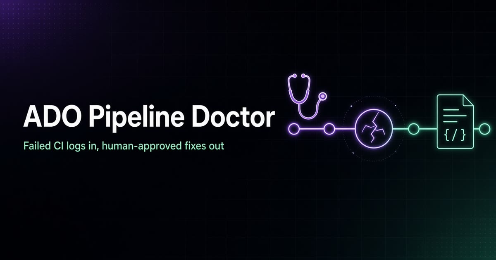
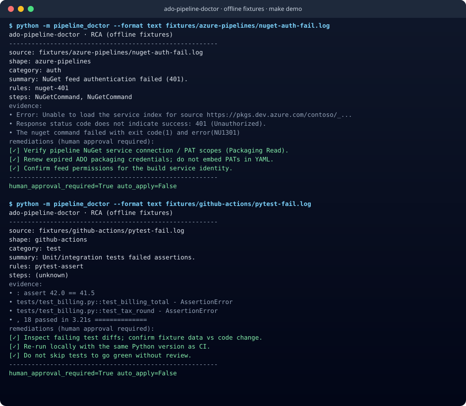
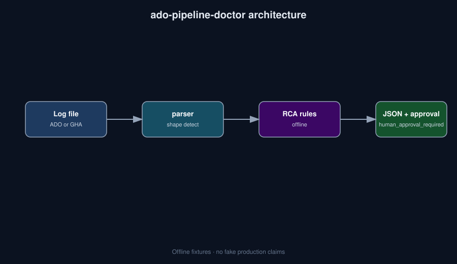
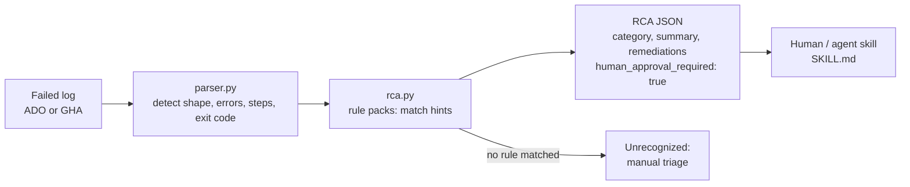

# ado-pipeline-doctor




[](docs/ci/demo.yml)

**Failed Azure Pipelines / GitHub Actions logs → structured RCA JSON. Remediations always require human approval.**

> Who it's for: DevOps / platform SAs who triage ADO and GHA failures daily.

## 30-second demo



```bash
python -m venv .venv && source .venv/bin/activate
pip install -e .
python -m pipeline_doctor --format text fixtures/azure-pipelines/nuget-auth-fail.log
python -m pipeline_doctor --format text fixtures/github-actions/pytest-fail.log
make demo
```

Regenerate SVG: `make demo-assets`. Loom script + LinkedIn caption: [`docs/DEMO.md`](./docs/DEMO.md).

## Why this exists

Red builds burn SA time. This doctor turns fixture (or real) failure logs into **root-cause hypotheses + remediations** with an explicit `human_approval_required: true` flag — safe to wire into an agent skill without auto-patching production YAML.

## Install

```bash
python -m venv .venv && source .venv/bin/activate
pip install -e .
```

Or with pipx (once published to PyPI): `pipx install ado-pipeline-doctor` — until then use editable install from this repo.

## What it is NOT

- Not an auto-healer that edits pipelines without approval
- Not a replacement for App Insights / proper incident process
- Not a hosted SaaS — offline CLI + skill docs
- No fabricated production-usage claims — fixtures only

## Design & Engineering

I designed this as a small, boring, trustworthy building block: something an agent can call to explain a red build, without ever being allowed to change the pipeline itself.

**Design goals**

- Turn a raw Azure Pipelines or GitHub Actions log into structured RCA JSON that a human or an agent can act on.
- Never auto-fix. Every result carries `human_approval_required: true`.
- Run offline on fixtures, so it is easy to test and demo with no tenant access.

**Architecture**





**Key design decisions and trade-offs**

| Decision | Why | Trade-off |
|---|---|---|
| Rules before LLMs | Deterministic, explainable, testable; same input always gives the same RCA | Only knows the failure patterns I have written rules for |
| A rule fires on 2+ matching hints | Cuts false positives from one stray word like "expired" | A very short log can miss a rule |
| Human approval flag is hard-coded | Safe to plug into an agent; it can suggest, never patch YAML | Someone still has to apply the fix |
| Explicit "unrecognized" result | Better to say "triage manually" than invent a cause | Less impressive output on unknown failures |

**Engineering details**

- **Stack:** Python 3.10+, standard library regex parsing, `argparse` CLI (`python -m pipeline_doctor`), text or JSON output.
- **Rule packs today:** NuGet 401, expired Azure service-connection secret (AADSTS7000222), GitHub Packages npm auth, pytest assertion failures.
- **Fixtures:** real-shaped logs in `fixtures/azure-pipelines/` and `fixtures/github-actions/`.
- **CI:** `make demo` runs the doctor on fixtures and asserts the approval flag is present; the workflow template is in [`docs/ci/demo.yml`](docs/ci/demo.yml).
- **Agent use:** [`SKILL.md`](SKILL.md) describes how an agent should call it and present the result.

**What I'd do next**

- More rule packs (npm cache, OIDC, service connections) and unit tests per rule.
- An optional LLM "explain" layer that must return the same JSON schema.
- A read-only Azure DevOps REST adapter behind a feature flag, so it can pull logs itself.

## Roadmap

- [ ] More rule packs (npm cache, NuGet, service connections, OIDC)
- [ ] Optional LLM explain layer behind the same JSON schema
- [ ] ADO REST adapter (read-only) behind a feature flag

## Contributing

See [CONTRIBUTING.md](./CONTRIBUTING.md). Be kind — [CODE_OF_CONDUCT.md](./CODE_OF_CONDUCT.md). Security reports: [SECURITY.md](./SECURITY.md).

## License

MIT
